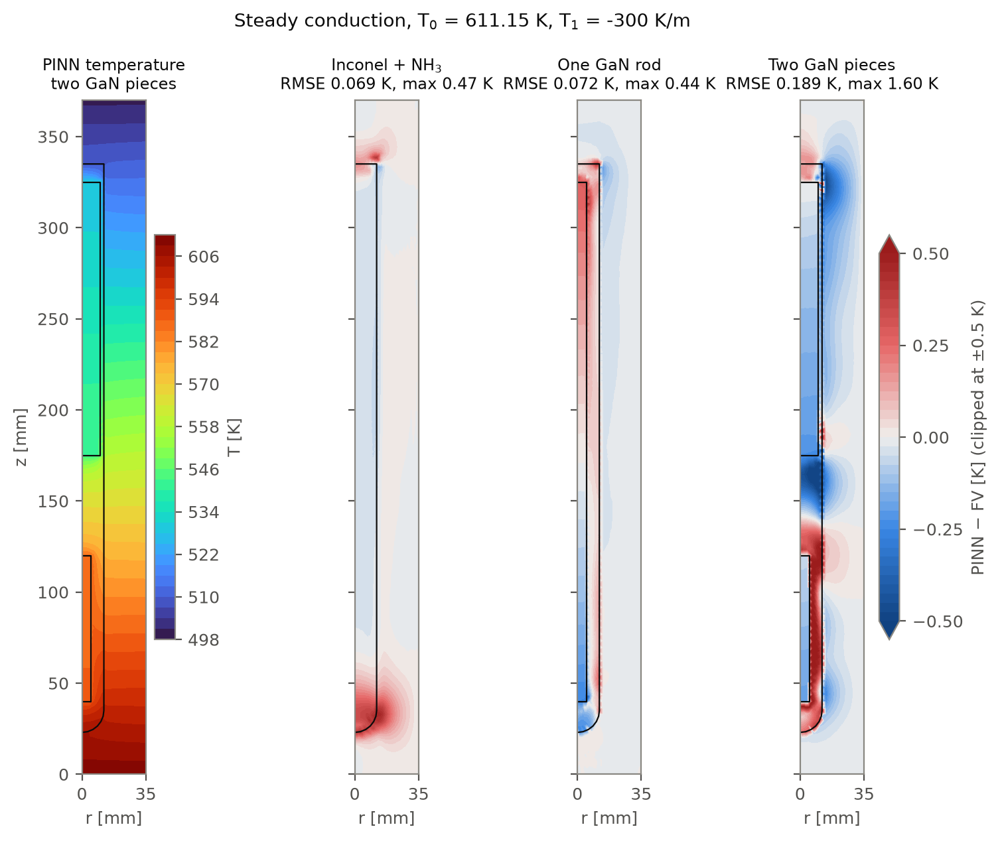

# Scientific Machine Learning for Ammonothermal GaN Crystal Growth

**Saikumar Kasumurthy Rajendra** · M.Sc. Clean Energy Processes, Friedrich-Alexander-Universität Erlangen-Nürnberg (FAU)

This repository collects my own work from my Master's thesis and research internship at the
Chair of Electron Devices (LEB), FAU. Both projects deal with **ammonothermal growth of gallium nitride (GaN)**,
where GaN crystals grow from supercritical ammonia (NH₃) inside a sealed high-pressure autoclave.

| Project | What it is | Tools |
|---|---|---|
| [**1. PINNs for heat transfer in the ammonothermal autoclave**](pinn_autoclave/) | Physics-informed neural networks for the temperature field in an Inconel autoclave filled with supercritical NH₃ and GaN, checked against finite-volume (CrysMAS) reference simulations | Python, JAX, [ScimBa](https://www.scimba.org/), Optax |
| [**2. GaN solubility in supercritical ammonia**](gan_solubility/) | Thermodynamic analysis of supercritical NH₃ and machine-learning modelling of GaN solubility data from the literature | Python, pandas, scikit-learn |

---

## 1. PINNs for heat transfer in the ammonothermal autoclave

*Master's thesis: "Physics-Informed Neural Networks for Modelling Ammonothermal Gallium Nitride Growth"*

The temperature field inside the autoclave controls where GaN dissolves and where it crystallises.
I built PINN models of the axisymmetric autoclave (Inconel 718 wall, NH₃ cavity, GaN parts) using
the JAX version of the ScimBa library. The models were developed step by step:

1. **Verification:** a 1D three-layer conduction problem with an analytical solution
2. **Single material, temperature-dependent conductivity k(T):** Inconel and NH₃, written in ScimBa *and* as a plain JAX/Optax implementation
3. **Multi-material 1D:** piecewise and smoothed conductivity at material interfaces
4. **2D axisymmetric autoclave, steady:** Inconel + NH₃, then with one GaN rod and with two GaN pieces, using one network per material region with interface coupling; one parametric model covers all wall temperature profiles of the CrysMAS data
5. **2D axisymmetric autoclave, transient:** heating of Inconel + NH₃ over 0 to 7200 s, with global space-time PINNs and time-discrete PINNs (implicit Euler and the Alexander scheme, with uniform and adaptive time steps)
6. **Navier–Stokes (in progress):** Boussinesq flow of NH₃ in 2D axisymmetric and 3D geometries

The 1D stages each cover a fixed case, **interpolation** and **extrapolation** to unseen boundary temperatures.

*Steady conduction, T₀ = 611.15 K, T₁ = −300 K/m: PINN temperature with two GaN pieces, and PINN minus CrysMAS for
the three final models (RMSE 0.069 K, 0.072 K and 0.189 K). More results in [`pinn_autoclave/README.md`](pinn_autoclave/).*

→ Details, how to run the scripts and the file overview: [`pinn_autoclave/README.md`](pinn_autoclave/)

## 2. GaN solubility in supercritical ammonia

My contribution to a manuscript (in preparation) consolidating the literature data on GaN solubility in
supercritical ammonia: the **thermodynamic analysis** of supercritical NH₃ (reduced properties, phase boundary,
fill-level P–T analysis) and the **machine-learning modelling** of the solubility data.

→ [`gan_solubility/`](gan_solubility/)

---

## Acknowledgements

- Supervisors: **Dr. Saskia Schimmel** (LEB, FAU), **Dr. Victor Michel-Dansac** (MoCo team, IRMA, Université de Strasbourg) and **Dr. Markus Zenk** (Fraunhofer IISB)
- The PINN models are built on **[ScimBa](https://gitlab.com/scimba/scimba)** (MIT licence), developed by Emmanuel Franck, Victor Michel-Dansac and colleagues. ScimBa is **not** included in this repository; it is installed as a dependency.
- My research visit to Strasbourg was funded by the *Technologies d'Avenir* mobility grant.

## Licence

My code in this repository is released under the [MIT licence](LICENSE).
Reference data from the chair's simulations are not included (see [`pinn_autoclave/data/`](pinn_autoclave/data/)).
