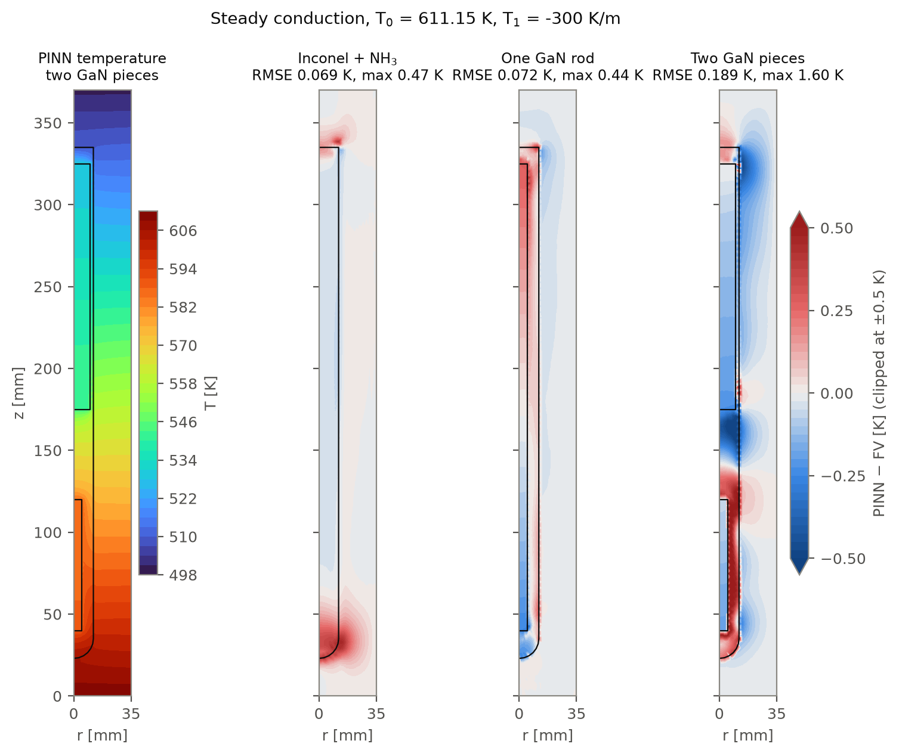
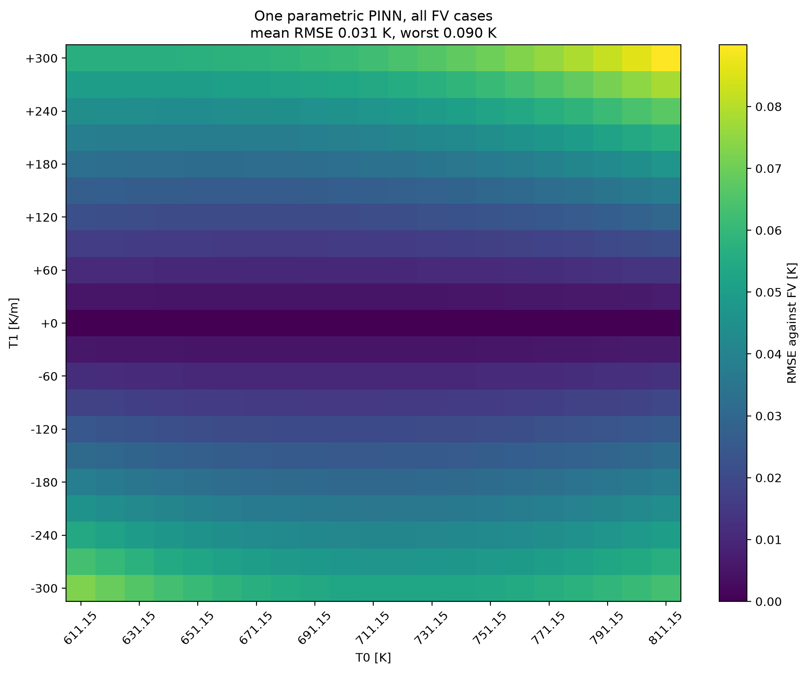
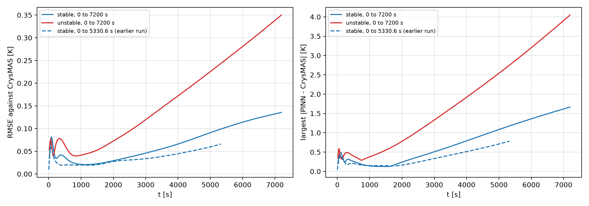
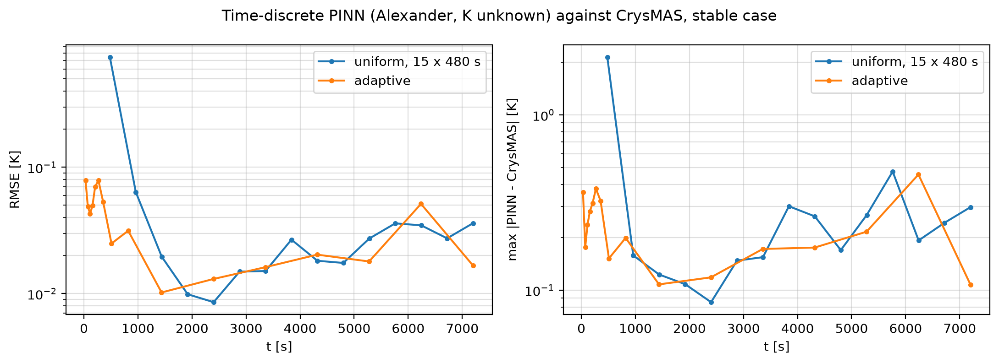
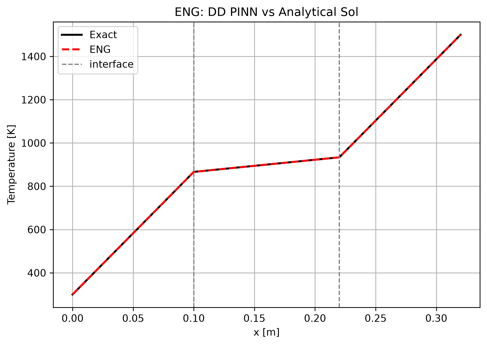

# PINNs for heat transfer in an ammonothermal GaN autoclave

Physics-informed neural networks (PINNs) for steady and transient heat conduction (and, as work in progress,
buoyancy-driven flow) in an autoclave for ammonothermal GaN growth. Written in Python with JAX and the
[ScimBa](https://www.scimba.org/) scientific machine-learning library.

## Physical model

- **Geometry:** axisymmetric (r, z) Inconel 718 autoclave, outer radius 35 mm, height 370 mm.
  The NH₃ cavity has a radius of 12 mm and reaches z = 335 mm. In the later cases it holds one GaN rod or two GaN pieces.
- **Steady equation:** ∇·(k(T) ∇T) = 0 in every material region, with the linear wall temperature profile
  T_outer(z) = T₀ + T₁·z on the outer autoclave wall
- **Transient equation:** ρ c_p ∂T/∂t = ∇·(k(T) ∇T) in the Inconel and the NH₃, starting from a uniform 300 K and
  heated by linear ramps of the bottom and top temperatures over 7200 s (stable case: to 723 K and 823 K;
  unstable case: to 950 K and 620 K)
- **Materials:**
  - Inconel 718: k(T) = 6.9995 + 0.0151·T W/(m·K)
  - supercritical NH₃: cubic correlation k(T)
  - GaN: k = 130 W/(m·K)
- **Interfaces:** continuity of temperature and heat flux between the materials
- **Reference:** finite-volume simulations with CrysMAS, compared at every node, along lines and as 2D error maps

## Method

- One neural network (MLP) per material region, coupled through interface residuals.
- Boundary and initial conditions are built into the trial function wherever possible. In the minimal scripts the
  trial function contains only the wall temperature law, and the networks learn the rest.
- The steady 2D models are parametric: the networks take (T₀, T₁) as an extra input, and one training covers the whole box
  T₀ ∈ [611.15, 811.15] K, T₁ ∈ [−300, 300] K/m.
- Transient models: a global space-time PINN (parametric in the ramp end temperatures), and a time-discrete PINN
  with implicit Euler or the third-order Alexander scheme, with uniform or adaptive time steps.
- Models are trained with ScimBa's JAX projectors, mostly with energy natural gradient (ENG). The 1D single-material
  problems are also written directly in JAX/Optax as an independent baseline.

## Results

RMSE of PINN minus CrysMAS in kelvin. Steady case shown: T₀ = 611.15 K, T₁ = −300 K/m.



*Steady conduction. Left: PINN temperature with two GaN pieces. Right: PINN minus CrysMAS for the final models
`inconel_nh3_parametric.py`, `one_gan_minimal.py` and `two_gan_minimal.py`.*

| Case | Script | Case shown | All (T₀, T₁) cases, mean / worst |
|---|---|---|---|
| Inconel + NH₃ | `inconel_nh3.py` (single case) | 0.060 | |
| Inconel + NH₃ | `inconel_nh3_parametric.py` | 0.069 | 0.051 / 0.076 (20 cases with T₁ ≠ 0) |
| One GaN rod | `one_gan_parametric_reference.py` | 0.076 | 0.041 / 0.092 (441 cases) |
| One GaN rod | `one_gan_minimal.py` | 0.072 | 0.031 / 0.090 |
| One GaN rod | `one_gan_minimal_hard_interfaces.py` | 0.486 | 0.254 / 0.499 |
| One GaN rod | `one_gan_minimal_K_unknown.py` | 0.101 | 0.053 / 0.122 |
| Two GaN pieces | `two_gan_parametric_reference.py` | 0.042 | 0.023 / 0.049 (441 cases) |
| Two GaN pieces | `two_gan_minimal.py` | 0.189 | 0.095 / 0.189 |
| Two GaN pieces | `two_gan_minimal_hard_interfaces.py` | 0.569 | 0.329 / 0.713 |
| Two GaN pieces | `two_gan_minimal_K_unknown.py` | 0.115 | 0.057 / 0.124 |

In the `*_reference.py` scripts most of the accuracy is already in an analytic starting profile; in the `*_minimal*.py`
scripts the networks learn everything beyond the wall law. The minimal runs used one seed (42).



*One GaN rod, `one_gan_minimal.py`: one training, RMSE on each of the 441 CrysMAS cases (mean 0.031 K, worst 0.090 K).*



*Transient heating, 0 to 7200 s, one parametric global PINN for both heating cases
(`transient_7200s_global_parametric_K_unknown.py`, seed 42): RMSE 0.077 K (stable) and 0.191 K (unstable) over the
whole run. The dashed line is the earlier run on the 0 to 5330.6 s window.*



*Time-discrete PINN with the Alexander scheme, stable case. Uniform steps (15 × 480 s,
`transient_7200s_discrete_K_unknown_alexander.py`) against adaptive steps that start at 30 s and grow while the
lag changes by at most 3 K per step (`transient_7200s_discrete_K_unknown_alexander_adaptive.py`): the largest RMSE
of a step falls from 0.745 K to 0.079 K, and the time-weighted RMSE from 0.194 K to 0.029 K.*



*Verification: 1D three-layer wall with constant k, PINN trained with ENG against the analytical solution
(`three_layer_constant_k.py`).*

## Repository layout

| Folder | Content |
|---|---|
| [`1_verification_1d_analytical/`](1_verification_1d_analytical/) | 1D three-layer conduction with constant k against the analytical solution: with and without interface temperature, a boundary-temperature sweep, and a space-discrete PINN version |
| [`2_single_material_1d/`](2_single_material_1d/) | 1D conduction with k(T) for Inconel and NH₃: fixed case, interpolation, extrapolation. `scimba/` holds the ScimBa versions, `plain_jax/` the hand-written JAX/Optax PINNs, and `conductivity_correlations.py` the k(T) correlations |
| [`3_multi_material_1d/`](3_multi_material_1d/) | 1D multi-material wall: piecewise and smoothed conductivity at the interfaces, each as fixed case, interpolation and extrapolation |
| [`4_autoclave_2d_heat/`](4_autoclave_2d_heat/) | Steady 2D axisymmetric autoclave: Inconel + NH₃, one GaN rod, two GaN pieces (scripts in the table above) |
| [`5_autoclave_2d_transient/`](5_autoclave_2d_transient/) | Transient heating of Inconel + NH₃: global, parametric and time-discrete PINNs on the 0 to 5330.6 s window (`transient_5330s_*`) and on the full 0 to 7200 s runs (`transient_7200s_*`) |
| [`6_navier_stokes_wip/`](6_navier_stokes_wip/) | **Work in progress:** Boussinesq Navier–Stokes. Steady 2D axisymmetric NH₃, 2D Inconel conduction coupled to NH₃ flow, 3D cylinder with hemispherical bottom (autoclave and water/air test cases), and transient heating with flow in the NH₃ (`transient_7200s_*_navier_stokes.py`) |
| [`figures/`](figures/) | The figures of this README |
| [`archive/`](archive/) | Earlier versions and drafts, kept for reference |

The docstrings of the 2D and transient scripts refer to each other by their original file names:

| Script here | Original name |
|---|---|
| `inconel_nh3.py` | `2D_heat_Inconel_+_Ammonia_victor_final.py` |
| `inconel_nh3_parametric.py` | `2D_heat_Inconel_+_Ammonia_parametric.py` |
| `inconel_nh3_parametric_minimal.py` | `2D_heat_Inconel_+_Ammonia_parametric_minimal.py` |
| `one_gan_parametric_reference.py` | `2D_heat_one_GaN_Part_parametric_extended.py` |
| `one_gan_minimal*.py` | `2D_heat_one_GaN_Part_parametric_minimal*.py` |
| `two_gan_parametric_reference.py` | `2D_heat_two_GaN_Parts_parametric.py` |
| `two_gan_minimal*.py` | `2D_heat_two_GaN_Parts_parametric_minimal*.py` |
| `transient_5330s_*.py` | `2D_heat_Inconel_+_Ammonia_transient_*.py` |
| `transient_7200s_*.py` | `2D_heat_Inconel_+_Ammonia_transient_7200s_*.py` |

## How to run

```bash
python -m venv .venv && source .venv/bin/activate
pip install -r ../requirements.txt

# reference data must be placed in pinn_autoclave/data/ (see data/README.md)
python 1_verification_1d_analytical/three_layer_constant_k.py   # needs no data
python 4_autoclave_2d_heat/one_gan_minimal.py
python 5_autoclave_2d_transient/transient_7200s_discrete_K_unknown_alexander_adaptive.py --seed 42
```

Python 3.11 or newer is needed (the scripts were checked with Python 3.14 and the versions in `requirements.txt`).
Outputs (figures, CSV metrics, loss histories) are written to an `output*/` folder in the current working directory.
The transient scripts take command-line options (`--help`). A GPU is recommended for the 2D cases.
